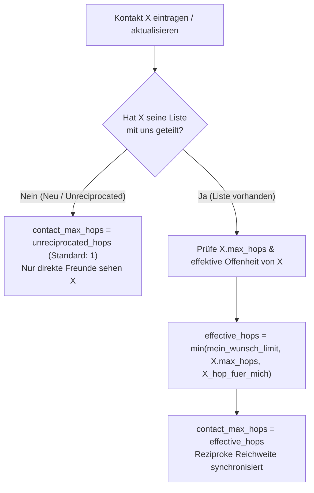

# ADR 0005: Reziprokes Routing und distanzbasierte Redaktion via SD-JWT

**Status:** Akzeptiert  
**Aktualisiert:** 30. Oktober 2026 (Distanzbasierte Redaktion, unbrechbare Signaturen, Tit-for-Tat-Anreizmodell & Policy-Deckelung)  
**Kontext:** Dezentrales Web of Trust / Routing / Privatsphäre  

---

## 1. Problemstellung

Um Pfade und Vertrauenswahrscheinlichkeiten ([ADR 0001](./adr-01-pfadberechnung-und-vertrauenswahrscheinlichkeiten.md)) über mehrere Zwischenstationen hinweg dezentral berechnen zu können, müssen Vertrauenslisten von Ausstellern im Netzwerk weitergeleitet werden. Hierbei entstehen zwei fundamentale Herausforderungen:

1. **Signaturerhaltende Reichweitenbegrenzung:** Wenn ein Zwischenknoten eine fremde Liste an einen Nachbarn weiterreicht, dürfen Kontakte, deren Reichweite erschöpft ist, nicht mehr sichtbar sein. Ein herkömmliches "Hochzählen eines Hop-Counters" im Dokument ist kryptographisch unmöglich, da jede Änderung an den Daten die Ed25519-Signatur des ursprünglichen Ausstellers zerstören würde.
2. **Das Schmarotzer-Problem (Free-Rider Dilemma):** Ein egoistischer Nutzer könnte maximale Privatsphäre für sich einfordern (z. B. Hop-Limit = 1), gleichzeitig aber davon profitieren, dass andere Nutzer ihre Listen weitflächig (z. B. Hop-Limit = 4) teilen. Ohne ein reziprokes Anreizmodell droht die "Tragik der Allmende": Das Netzwerk trocknet informationell aus, da Pfade zwischen Unbekannten nicht mehr auffindbar sind.
3. **Der selektive Großzügigkeits-Trick:** Ein schlau agierender Nutzer X könnte versuchen, einen gut vernetzten Knoten B zu ködern, indem er B in seiner Liste ein hohes Limit ($4$ Hops) einräumt, aber alle anderen Einträge in seiner Liste auf $0$ oder $1$ hält oder gar keine echten Kanten teilt. Eine naive 1:1-Spiegelung würde X unverdiente Reichweite verschaffen.

---

## 2. Getroffene Entscheidung

Wir etablieren ein **distanzbasiertes Redaktionsverfahren** in Kombination mit einer **robusten Tit-for-Tat-Policy**, die das Drahtformat schlank hält und die mathematische Integrität der SD-JWT-Signaturen garantiert.

---

### A. Distanzbasierte Redaktion (Signaturerhaltendes Weiterleiten)

Ein weiterleitender Knoten verändert **niemals** Zahlen, Zähler oder Payload-Felder innerhalb des signierten SD-JWTs. Stattdessen erfolgt die Filterung rein über das **Weglassen von Klartext-Disclosures** vor dem Weiterversand:

```
[Aussteller A] ──(Gossip-Weg / Distanz d)──> [Knoten B] ──(Weiterleitung)──> [Empfänger C]
```

#### Der Algorithmus:
1. **Bestimmung der lokalen Pfaddistanz $d$:**
   Möchte Knoten $B$ eine gespeicherte Vertrauensliste von Aussteller $A$ an Nachbar $C$ weiterleiten, ermittelt $B$ in seinem lokalen Ego-Graphen die kürzeste gerichtete Distanz $d = \text{dist}(B \to A)$ (vom Wurzelknoten `Self`/B zum Aussteller A) über verifizierte Kanten mit $\text{level} \ge 1$:
   *   Für $B$'s eigene Liste ($A = B$) gilt: $d = 0$.
   *   Für direkte Kontakte von $B$ (gerichtete Kante $B \to A$, Hop-1) gilt: $d = 1$.
   *   Für Kontakte über Zwischenstationen ($B \to \dots \to A$) gilt: $d \ge 2$.
   *(Reine Stufe-0-Kanten besitzen $\gamma = 0.0$ und bilden keine Transit-Brücke; sie zählen nicht zur Distanz- oder Pfadermittlung).*
2. **Prüfung des Ziel-Abstands $d_{\text{ziel}}$:**
   Für Empfänger $C$ wird die Liste von $A$ auf der Distanz $d_{\text{ziel}} = d + 1$ liegen.
3. **Filter-Entscheidung:**
   *   **Paket-Ebene (Ganze Liste):**
       $$\text{Liste übertragen} \iff A.\text{max\_hops} \ge d_{\text{ziel}}$$
       Gilt $d_{\text{ziel}} > A.\text{max\_hops}$ (bzw. $A.\text{max\_hops} < d_{\text{ziel}}$), wird $A$'s Liste **gar nicht** an $C$ übertragen.
   *   **Kontakt-Ebene (Selektive Disclosure-Redaktion):**
       Andernfalls prüft $B$ für jede im SD-JWT enthaltene Disclosure den deklarierten Wert `contact_max_hops`:
       $$\text{Disclosure behalten} \iff \text{contact\_max\_hops} \ge d_{\text{ziel}}$$
4. **Signaturerhalt:** Alle Disclosures, für die $\text{contact\_max\_hops} < d_{\text{ziel}}$ gilt, werden vor dem Senden an $C$ aus dem SD-JWT-String entfernt. Da das im JWS unverändert signierte `_sd`-Array alle Digests beibehält, prüft $C$ die Ed25519-Signatur von $A$ mathematisch fehlerfrei, sieht jedoch für abgelaufene Kontakte nur noch unlesbare Digests.

---

### B. Das Tit-for-Tat-Anreizmodell (Reziproke Sichtbarkeit)

Auf Drahtebene ist `contact_max_hops` einfach eine 8-Bit-Ganzzahl ($0..8$). Wie ein Knoten diesen Wert festlegt, wird durch eine **lokale Wallet-Policy** geregelt:



#### 1. Basis-Sichtbarkeit vor Gegenleistung (`unreciprocated_hops`):
*   Fügt ein Nutzer einen neuen Kontakt $X$ hinzu (z. B. beim ersten persönlichen Treffen via QR/BLE) und hat $X$ noch keine eigene Vertrauensliste geliefert, vergibt die Policy standardmäßig:
    $$\text{contact\_max\_hops} = \text{unreciprocated\_hops} \quad (\text{Standard: } 1)$$
*   **Wirkung:** Direkte Freunde von $B$ sehen die Kante zu $X$ ($d_{\text{ziel}} = 1 \le 1$). Bei einer Weiterleitung an Dritte ($d_{\text{ziel}} = 2$) wird $X$ jedoch sofort geschwärzt. Niemand wird vorab großflächig ins Netzwerk propagiert, bevor er nicht selbst kooperiert. (Der Wert ist in der lokalen Wallet-Policy konfigurierbar, z. B. $1$ oder $0$, ohne das Drahtformat zu berühren).

#### 2. Schutz gegen den „selektiven Großzügigkeits-Trick“:
Sobald $X$ seine signierte Vertrauensliste mit $B$ teilt, spiegelt $B$ den Wert nicht blind aus $X$' Eintrag für $B$, sondern deckelt ihn durch die **effektive Offenheit von $X$' Liste**:

$$\text{effective\_hops\_for\_X} = \min\big(\text{mein\_wunsch\_limit},\; X.\text{max\_hops},\; X.\text{hop\_fuer\_mich}\big)$$

*   **Regel bei fehlender Reziprozität:** Teilt $X$ zwar eine Liste, aber diese enthält überhaupt keine weiterleitbaren Kanten ($\text{level} \ge 1$) oder $X$' globales $X.\text{max\_hops} \le 1$, verharrt das Limit für $X$ bei $\text{unreciprocated\_hops}$.
*   **Spieltheoretische Stabilität:** Ein Nutzer erlangt nur dann weite Sichtbarkeit (Reputation bei Dritten) im Gesamtsystem, wenn er selbst gewillt ist, sein globales Limit $X.\text{max\_hops}$ zu öffnen und substantielle Vertrauensdaten beizutragen.

---

## 3. Rationale

1. **Mathematische Unangreifbarkeit:** Indem der weiterleitende Knoten nichts signiert und nichts modifiziert, sondern lediglich Disclosures weglässt, gibt es keine Angriffsfläche für gefälschte Distanzzähler. Die Signatur schützt die Zuordnung `(target_did, level, contact_max_hops)` unveränderbar.
2. **Keine Konsens- oder Verhandlungsrunden:** Das Verfahren arbeitet vollständig reaktiv und asynchron. Es ist keine interaktive Challenge-Response-Verhandlung nötig. Der lokale Client entscheidet autonom über seine ausgehenden Disclosures und sein lokales Vertrauensregister.

---

## 4. Konsequenzen

### Positiv
*   **Robuste Spieltheorie:** Das Schmarotzer-Problem wird ohne zentrale Instanz gelöst. Ehrliche, kooperative Teilnehmer erhalten maximale Reichweite; isolierte Teilnehmer bleiben lokal begrenzt.
*   **Vollständige Datenökonomie:** Datenpakete schrumpfen mit jedem Hop ganz natürlich, da abgelaufene Disclosures weggelassen werden.
*   **Kein Krypto-Bruch:** Die Ed25519-Signatur des Ausstellers übersteht beliebig viele Zwischenstationen.

### Zu beachten bei der Implementierung
*   **Graph-Abstand vor Redaktion berechnen:** Vor dem Serialisieren eines ausgehenden SD-JWTs muss das Crate die lokale Distanz $d = \text{dist}(B, A)$ im `EgoGraphCache` nachschlagen.
*   **Keine Offenlegung von Redaktionsgründen:** Für den Empfänger ist ein entfernter Kontakt nicht von einem Decoy-Digest zu unterscheiden.
