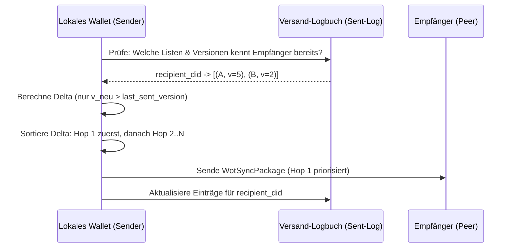
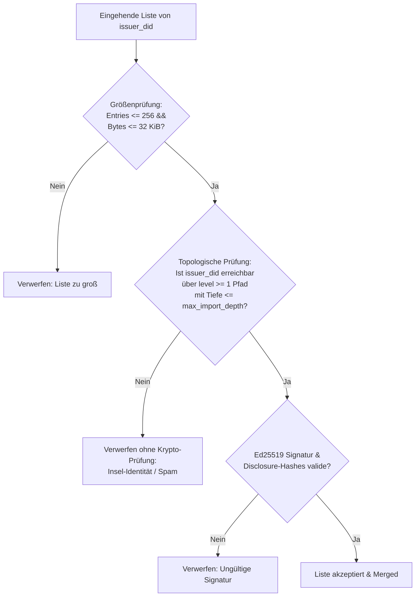

# ADR 0006: Asynchrones Gossip-Protokoll, Delta-Sync & Spam-Schutz

**Status:** Akzeptiert  
**Aktualisiert:** 30. Oktober 2026 (Topologischer Spam-Filter, Versions-Ersatz & Union-Merge, Transport-Entkopplung)  
**Kontext:** Dezentrales Web of Trust / Synchronisation / Netzwerk-Sicherheit  

---

## 1. Problemstellung

Das Web of Trust in HuMoCo funktioniert dezentral und offline-first. Nutzer tauschen Vertrauenslisten (SD-JWTs aus [ADR 0004](./adr-04-sd-jwt-vertrauenslisten.md) und [ADR 0005](./adr-05-reziprokes-routing-sd-jwt.md)) über asynchrone, bandbreitenbegrenzte Kanäle aus: bei flüchtigen persönlichen Begegnungen (NFC, QR-Code-Pagination, BLE), als Huckepack-Payload (Piggybacking) in Zahlungen von `human-money-core`, über verschlüsselte Peer-to-Peer-Nachrichten oder über optionale Community-Relays.

Hierbei entstehen drei kritische Herausforderungen:

1. **Effizienz & Redundanz-Vermeidung:** Vollständige Vertrauensgraphen umfassen Dutzende Listen. Ein ständiges Neuübertragen unveränderter Listen würde QR-Codes und Funkübertragungen unbrauchbar machen.
2. **Spam- und DoS-Resilienz (Sybil-Flutung):** Ein böswilliger Peer könnte ein Paket mit 50.000 künstlich generierten `did:key`-Schlüsselpaaren und Fake-Listen senden, um die CPU des Empfängers mit Ed25519-Signaturprüfungen zu überlasten und den Speicher zu sprengen.
3. **Konfliktfreie Konsolidierung (Teil-Informationen):** Da dieselbe Vertrauensliste einer Person über zwei verschiedene Freunde unterschiedlich stark redigiert (geschwärzt) beim selben Empfänger eintreffen kann, müssen Regeln für Versionierung und Zusammenführung (Merge) definiert sein.

---

## 2. Getroffene Entscheidung

Wir implementieren ein zustandsbehaftetes, unidirektionales **Delta-Sync-Protokoll**, geschützt durch einen **topologischen Erreichbarkeits-Filter** und deterministische **Union-Merge-Regeln**.

---

### A. Zustandsbehaftetes Versand-Logbuch (Sent-Log) & Hop-Priorisierung

Das Crate `humoco-wot` verwaltet rein lokal ein persistentes Versand-Logbuch:
$$\text{recipient\_did} \longrightarrow \big[ (\text{issuer\_did}, \text{last\_sent\_version}, \text{sent\_at}) \big]$$



#### 1. Push-basiertes Delta:
*   Möchte Alice ein Datenpaket für Bob schnüren, prüft ihr Wallet rein lokal im Sent-Log, welche Versionen welcher Listen Bob bereits erhalten hat.
*   Es werden **ausschließlich** Listen exportiert, für die $v_{\text{lokal}} > v_{\text{gesendet}}$ gilt, oder solche, die Bob noch nie erhalten hat.
*   Dies funktioniert rein unidirektional: Alice muss vorab kein Manifest bei Bob anfragen.

#### 2. Hop-Priorisierung (Progressive Übertragung):
*   Die im Delta enthaltenen Listen werden strikt nach der gerichteten Pfaddistanz $d = \text{dist}(\text{Self} \to \text{Aussteller})$ im lokalen Ego-Graphen sortiert:
    1. Eigene Liste des Senders ($d = \text{dist}(\text{Self} \to \text{Self}) = 0$)
    2. Direkte Kontakte des Senders ($d = \text{dist}(\text{Self} \to \text{Aussteller}) = 1$)
    3. Listen entfernterer Kontakte ($d = \text{dist}(\text{Self} \to \text{Aussteller}) \ge 2$)
*   Bricht eine Übertragung mit begrenztem Zeitfenster (z. B. NFC-Tap, kurze BLE-Nähe oder QR-Scan-Abbruch) vorzeitig ab, wurden die für die Pfadberechnung wertvollsten Kanten (Distanz 1) bereits vollständig übertragen.

---

### B. Spam- & DoS-Schutz: Der topologische Erreichbarkeits-Filter

Um Denial-of-Service-Angriffe durch unverbundene Sybil-Armeen abzuwehren, wendet der Empfänger einen **strengen dreistufigen Einlass-Filter** an:



#### 1. Verarbeitungsreihenfolge:
Eingehende Listen innerhalb eines `WotSyncPackage` werden **strikt aufsteigend nach Distanz** importiert (erst Listen des direkten Gegenübers, dann sukzessive tiefere Hops). Dadurch baut sich der Graph schrittweise von innen nach außen auf.

#### 2. Der Topologische Filter:
Eine fremde Liste von `issuer_did` wird **nur dann akzeptiert und kryptographisch geprüft**, wenn `issuer_did` im lokalen Graphen über verifizierte Kanten mit $\text{level} \ge 1$ innerhalb von `max_import_depth` (Standard: $5$ Hops) erreichbar ist!
*   **Abweisung von Insel-Listen:** Erhält der Empfänger eine Liste einer Identität, zu der kein Pfad mit $\text{level} \ge 1$ existiert, wird die Liste **sofort und ohne jede teure Signaturprüfung verworfen**.
*   **Ausschluss reiner Stufe-0-Pfade:** Reine Stufe-0-Bestätigungen (bloße Existenz, 0 % Haftung) berechtigen **nicht** zum Import tieferer Listen.
*   **Feste Kapazitätsgrenzen:** Jede Liste darf maximal $256$ Einträge und maximal $32\text{ KiB}$ umfassen. Überschreitungen führen zum sofortigen Abbruch.

---

### C. Versions-Ersatz & deterministischer Union-Merge

Für jede ankommende, topologisch zulässige und kryptographisch gültige Liste von `issuer_did` gelten exakte Zustandsübergänge im lokalen `raw_list_store`:

| Szenario | Bedingung | Aktion im lokalen Register |
|---|---|---|
| **Neuere Version** | $v_{\text{neu}} > v_{\text{gespeichert}}$ | **Vollständiger Ersatz:** Die alte Liste wird gelöscht und durch die neue Version ersetzt. Der Graphen-Cache wird aktualisiert. |
| **Ältere Version** | $v_{\text{neu}} < v_{\text{gespeichert}}$ | **Ignorieren:** Veraltete Version wird lautlos verworfen. |
| **Gleiche Version & identischer JWS-Body** | $v_{\text{neu}} == v_{\text{gespeichert}}$ und $\text{JWS}_{\text{neu}} == \text{JWS}_{\text{gespeichert}}$ | **Union-Merge der Disclosures:** Neue, bisher nicht vorhandene Disclosures werden zur bestehenden Disclosure-Menge hinzugefügt. |
| **Equivocation-Konflikt** | $v_{\text{neu}} == v_{\text{gespeichert}}$, aber $\text{JWS}_{\text{neu}} \ne \text{JWS}_{\text{gespeichert}}$ | **Determinismus:** Der Aussteller hat zwei widersprüchliche Listen mit gleicher Version signiert. Es wird die Liste mit dem lexikographisch kleineren SHA-256-Hash des JWS-Körpers behalten; die andere wird verworfen. **Niemals Disclosures aus unterschiedlichen JWS-Körpern mischen!** |

#### Rationale für den Union-Merge:
Hat Carol dieselbe Liste (Version 5) von Alice einmal über Bob (2 Hops entfernt, stark redigiert) und einmal über Dave (1 Hop entfernt, kaum redigiert) erhalten, enthält Daves Paket zusätzliche Klartext-Disclosures. Da der signierte JWS-Teil (`iss`, `v`, `iat`, `max_hops`, `_sd`) exakt übereinstimmt, ist die Vereinigung der Disclosures mathematisch konsistent und erweitert Carols Graphwissen, ohne Alices Signatur zu gefährden.

---

### D. Saubere Transport-Entkopplung

Das Crate `humoco-wot` operiert als reine Zustands- und Datenverarbeitungs-Engine:
*   **Input/Output:** Es erzeugt und parst das strukturierte Format `WotSyncPackage`:
    ```json
    {
      "format_version": 1,
      "lists": [
        "<sd_jwt_string_1>",
        "<sd_jwt_string_2>"
      ]
    }
    ```
*   **Transport-Agnostisch:** Wie das `WotSyncPackage` übertragen wird, obliegt der Host-Anwendung:
    *   Eingebettet in das `TransactionBundle` von `human-money-core` via Hook-Interface.
    *   Verschlüsselt im `SecureContainer` (JWE General Serialization).
    *   Direkt als binäre oder komprimierte Payload über BLE/NFC oder animierte QR-Codes.

---

## 3. Konsequenzen

### Positiv
*   **Extrem sparsame Bandbreite:** Unidirektionaler Delta-Push verhindert Daten-Redundanz ohne zeitraubende Zwei-Wege-Aushandlung.
*   **Immunität gegen Spam-Flutung:** Angreifer können mit Fake-Schlüsseln das System nicht überlasten, da fremde Insel-Daten ohne Pfad sofort an der topologischen Schranke abprallen.
*   **Robuste Datenkonsolidierung:** Teilweise geschwärzte Listen derselben Version ergänzen sich harmonisch.

### Zu beachten bei der Implementierung
*   **Pfad-Aktualisierung im Import-Loop:** Nach erfolgreichem Import einer Hop-1-Liste müssen neu erschlossene Kontakte sofort für nachfolgende Hop-2-Listen im selben Sync-Lauf verfügbar sein.
*   **Persistenz des Sent-Logs:** Das Sent-Log muss atomar mit dem Vertrauensregister abgespeichert werden.
