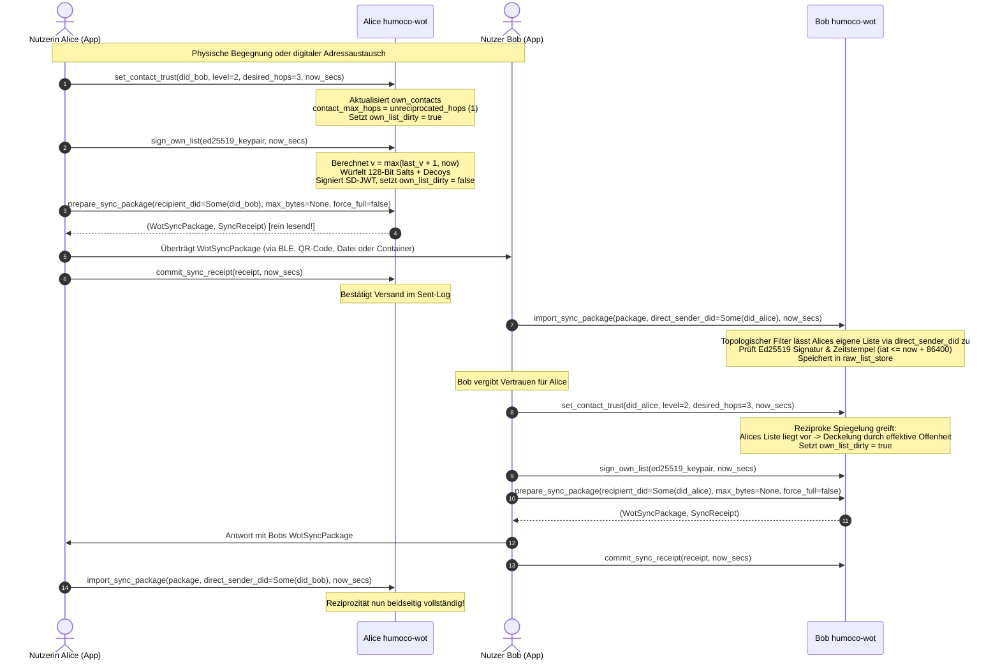

# ADR 0007: Datenstruktur, Speicher-Architektur & Schnittstellen (humoco-wot)

**Status:** Akzeptiert  
**Datum:** 30. Oktober 2026  
**Kontext:** Dezentrales Web of Trust / Crate-Spezifikation / Rust-Implementierung  
**Bezieht sich auf:** WOT-001 (Schema), WOT-002 (Core-Schnittstellen), WOT-006 (Handschlag/Sync-Workflow), WOT-009 (Dual-Storage)  

---

## 1. Problemstellung

Die theoretischen und kryptographischen Grundlagen des Web of Trust von HuMoCo wurden in den [ADR 0001](./adr-01-pfadberechnung-und-vertrauenswahrscheinlichkeiten.md) (Pfadberechnung & Wahrscheinlichkeiten), [ADR 0003](./adr-03-ui-design-vertrauen-haftung.md) (Vertrauensstufen), [ADR 0004](./adr-04-sd-jwt-vertrauenslisten.md) (SD-JWT Drahtformat), [ADR 0005](./adr-05-reziprokes-routing-sd-jwt.md) (Distanzbasierte Redaktion & Tit-for-Tat) und [ADR 0006](./adr-06-asynchrones-gossip-protokoll.md) (Gossip, Delta-Sync & Spam-Filter) definiert.

Für die Implementierung des eigenständigen Rust-Crates `humoco-wot` fehlen jedoch die konkreten Spezifikationen der internen Datenhaltung, der Speicher-Architektur, des initialen Vertrauens-Workflows („Handschlag“) und der Programmierschnittstellen (APIs) zu `human-money-core` und der `human-money-app`.

Konkret müssen vier zentrale Fragestellungen gelöst werden:
1. **Rolle & Abgrenzung:** Wie bleibt `humoco-wot` modular, platformunabhängig und WASM-kompatibel, ohne I/O-, Netzwerk- oder UI-Ballast?
2. **Dual-Storage-Architektur (WOT-001 & WOT-009):** Wie können unveränderte kryptographische Rohdaten (SD-JWTs) für die spätere Weitergabe mit unversehrten Ed25519-Signaturen gespeichert werden, während gleichzeitig Pfadberechnungen und Distanzabfragen im Millisekundenbereich auf schnellen Graphstrukturen ablaufen?
3. **Initialer Vertrauensaufbau & Sync (WOT-006):** Wie gestaltet sich der Ablauf, wenn zwei Nutzer aufeinandertreffen und Vertrauen begründen?
4. **Programmierschnittstellen & Core-Kompatibilität (WOT-002):** Wie interagiert das Crate mit `human-money-core` (insbesondere dem Trait `TrustProvider` und Adress-Normalisierung) und der Host-App?

---

## 2. Getroffene Entscheidungen

---

### A. Rolle, Scope & Leitlinien von `humoco-wot`

Das Crate `humoco-wot` ist als reine, zustandsfähige Rust-Bibliothek konzipiert:
*   `#![forbid(unsafe_code)]` für maximale Speichersicherheit.
*   **WASM-Kompatibilität:** Kompiliert sowohl für `x86_64-unknown-linux-gnu`, macOS, Windows als auch für `wasm32-unknown-unknown` (Browser/Tauri-Frontend) und mobile Plattformen (Android/iOS).
*   **Zero Network Sockets:** Das Crate öffnet keine TCP-, UDP- oder QUIC-Verbindungen. Der Transport von Datenpaketen obliegt vollständig der Host-Applikation oder den Transaktions-Hooks von `human-money-core`.
*   **Zero Storage-Encryption:** Das Crate kümmert sich nicht um Festplatten-Verschlüsselung. Es serialisiert und deserialisiert das `TrustRegister` atomar (z. B. via `serde_json`). Die verschlüsselte Ablage im Profilverzeichnis übernimmt die Host-App (z. B. Tauri App Data Store mit SQLCipher oder verschlüsselter Datei).

---

### B. Dual-Storage-Architektur & Datenmodell (`TrustRegister`)

Um die widersprüchlichen Anforderungen zwischen **kryptographischer Signaturtreue** (unveränderte JWS-Körper für Weiterleitungen) und **algorithmischer Pfadsuche** (hohe Traversierungs-Performance) zu lösen, teilen wir die Datenhaltung strikt in zwei Schichten:

```mermaid
graph TD
    subgraph Persistente Speicherschicht ["1. Persistente Schicht (TrustRegister / JSON)"]
        OwnContacts["own_contacts: BTreeMap<Did, OwnTrustEntry>"]
        OwnSignedList["own_signed_list: Option<StoredSdJwt>"]
        RawListStore["raw_list_store: BTreeMap<Did, StoredSdJwt><br/>(JWS-Body + Disclosures für Weiterleitung)"]
        SentLog["sent_log: BTreeMap<Did, BTreeMap<Did, SentRecord>>"]
        Policy["policy: WotPolicy"]
    end

    subgraph RuntimeCache ["2. Flüchtige In-Memory Schicht (EgoGraphCache)"]
        IndexMap["NodeIndex: BiMap<Did, u32>"]
        AdjList["Adjazenzliste: Vec<SmallVec<[(u32, u8, u8)]>>"]
        DistanceCache["Distanz-Matrix & Kanten-Dämpfung"]
    end

    Persistente Speicherschicht -- "Inkrementell on-change aufgebaut" --> RuntimeCache
    RuntimeCache -- "Sub-ms Pfadsuche & Distanzermittlung" --> Eval["evaluate_voucher() & dist(B -> A)"]
```

#### 1. Persistentes Datenmodell (`TrustRegister`):

```rust
use std::collections::BTreeMap;
use serde::{Deserialize, Serialize};

/// Kanonischer did:key Identifier (z. B. "did:key:z6MkuV8...")
pub type Did = String;

/// 22-stelliger Base64URL-String (128-Bit SHA-256 Digest)
pub type Digest128 = String;

/// Zentraler persistenter Zustands-Speicher des Nutzers
#[derive(Debug, Clone, Serialize, Deserialize)]
pub struct TrustRegister {
    /// Eigene kanonische Identität des Nutzers
    pub self_did: Did,

    /// Eigene direkte Kontakte und vergebene Vertrauenseinstufungen
    pub own_contacts: BTreeMap<Did, OwnTrustEntry>,

    /// Die aktuellste eigene signierte Vertrauensliste
    pub own_signed_list: Option<StoredSdJwt>,

    /// Flag, ob die eigene Liste neu signiert werden muss (wird bei Änderungen an own_contacts
    /// UND automatisch beim Import gesetzt, falls sich ein effektives Tit-for-Tat-Hop-Limit ändert)
    pub own_list_dirty: bool,

    /// Empfangene fremde Vertrauenslisten (Rohdaten für signaturtreue Weiterleitung)
    pub raw_list_store: BTreeMap<Did, StoredSdJwt>,

    /// Versand-Logbuch zur Vermeidung redundanter Gossip-Daten
    pub sent_log: BTreeMap<Did, BTreeMap<Did, SentRecord>>,

    /// Lokale Auswertungs- und Synchronisations-Regeln
    pub policy: WotPolicy,
}

#[derive(Debug, Clone, Serialize, Deserialize)]
pub struct OwnTrustEntry {
    /// Vertrauensstufe: 0 (Existenz), 1 (30%), 2 (60%), 3 (85%)
    pub level: u8,
    /// Vom Nutzer gewünschtes Weitergabelimit für diesen Kontakt (z. B. 1..8)
    pub desired_hops: u8,
    /// Zeitstempel der letzten Änderung (Unix-Sekunden)
    pub updated_at: u64,
}

/// Wire-Format der unverschlüsselten JWS-Payload (Claims gemäß ADR 0004)
#[derive(Debug, Clone, Serialize, Deserialize)]
pub struct SdJwtPayload {
    /// Kanonische did:key des Ausstellers
    pub iss: Did,
    /// Monotone Versionsnummer: v = max(last_v + 1, current_unix_seconds)
    pub v: u64,
    /// Ausstellungszeitpunkt (Unix-Sekunden)
    pub iat: u64,
    /// Globales Weitergabelimit dieser Liste (u8, 1..8)
    pub max_hops: u8,
    /// Lexikographisch sortierte 128-Bit-Digests echter Disclosures und Decoys (22-stellig Base64URL)
    pub _sd: Vec<Digest128>,
}

#[derive(Debug, Clone, Serialize, Deserialize)]
pub struct StoredSdJwt {
    /// Kompakter JWS-String: "<header_b64>.<payload_b64>.<signature_b64>"
    pub jws_compact: String,
    /// Version der Liste (JWS Claim "v")
    #[serde(alias = "version")]
    pub v: u64,
    /// Ausstellungszeitpunkt in Unix-Sekunden (JWS Claim "iat")
    #[serde(alias = "issued_at")]
    pub iat: u64,
    /// Globales Weitergabelimit des Ausstellers (JWS Claim "max_hops")
    #[serde(alias = "global_max_hops")]
    pub max_hops: u8,
    /// Zugehörige verifizierte Disclosures, indiziert nach ihrem 128-Bit-Digest
    pub disclosures: BTreeMap<Digest128, DisclosureRecord>,
}

#[derive(Debug, Clone, Serialize, Deserialize)]
pub struct DisclosureRecord {
    /// Roher Base64URL-kodierter Disclosure-String
    pub raw_b64: String,
    /// Ziel-DID des Kontakts
    pub target_did: Did,
    /// Vertrauensstufe (0..3)
    pub level: u8,
    /// Erlaubtes Weitergabelimit für diesen Kontakt
    pub contact_max_hops: u8,
}

#[derive(Debug, Clone, Serialize, Deserialize)]
pub struct SentRecord {
    /// Zuletzt an diesen Empfänger übertragene Version
    pub version: u64,
    /// Sendezeitpunkt (Unix-Sekunden)
    pub sent_at: u64,
    /// 64-Bit Fingerabdruck der übermittelten Disclosures (erkennt Nachlieferungen nach Union-Merge bei identischer Version)
    pub disclosure_fingerprint: u64,
}

#[derive(Debug, Clone, PartialEq, Serialize, Deserialize)]
#[serde(default)]
pub struct WotPolicy {
    /// Standard-Hop-Limit für Kontakte, die noch keine Liste geliefert haben
    pub unreciprocated_hops: u8, // Standard: 1
    /// Maximale Graph-Tiefe für den Import fremder Listen (Spam-Schutz)
    pub max_import_depth: u8,    // Standard: 5
    /// Globales Weitergabelimit der eigenen Liste (Standard: 4)
    pub own_list_max_hops: u8,
    /// Maximale Graph-Tiefe bei Pfad- und Vertrauensauswertungen (Standard: 4)
    pub max_eval_depth: u8,
    /// Gewichtungsfaktor für Garanten/Bürgen bei Gutscheinprüfung
    pub guarantor_weight: f64,   // Standard: 0.85
    /// Optionale Altersdämpfung: Halbwertszeit in Sekunden (z. B. 180 Tage = 15.552.000 s)
    pub freshness_half_life_secs: Option<u64>,
}
```

#### 2. Flüchtiger Laufzeit-Cache (`EgoGraphCache`):
Für die Pfadsuche und Distanzberechnungen wird aus `own_contacts` und `raw_list_store` ein In-Memory-Graph aufgebaut:
*   **Kompakte Knoten-Indizes:** DIDs werden auf fortlaufende `u32`-IDs abgebildet.
*   **Adjazenzliste:** Gerichtete Kanten speichern `(target_node_id: u32, level: u8, contact_max_hops: u8)`.
*   **Ausschluss von Stufe 0:** Kanten mit `level == 0` (Mensch-Existenz, $\gamma = 0.0$) werden **nicht** in die Pfadtraversierung des `EgoGraphCache` aufgenommen, da sie keine Transit-Brücke bilden (verhindert Datenballast und Fehlberechnungen).
*   **Gerichtete Pfaddistanz:** Die Distanz $\text{dist}(\text{Self} \to \text{Aussteller})$ (bzw. $\text{dist}(B \to A)$) ermittelt die Länge des kürzesten gerichteten Pfades vom lokalen Wurzelknoten (`Self`) zum Aussteller über verifizierte Kanten mit $\text{level} \ge 1$.
*   **Inkrementelle Pflege:** Der Cache wird on-demand oder bei Änderungen an `TrustRegister` aktualisiert.
*   **Performance:** Pfadsuchen mit Tiefenbegrenzung ($d \le 4$) dauern im Ego-Graphen weniger als 1 Millisekunde.

#### 3. Shared-Edge Factoring bei der Pfadberechnung:
Bei der Zusammenführung mehrerer Pfade ([ADR 0001](./adr-01-pfadberechnung-und-vertrauenswahrscheinlichkeiten.md)) gilt das Prinzip des **Shared-Edge Factorings**:
*   Wenn zwei Pfade $A \to B \to C \to E$ und $A \to B \to D \to E$ dieselbe erste Kante $A \to B$ teilen, dürfen diese Pfade nicht als völlig unabhängige Ereignisse behandelt werden.
*   Der gemeinsame Flaschenhals (Bottleneck-Kante $A \to B$) wird herausfaktorisiert:
    $$\text{Vertrauen} = \text{Kante}(A \to B) \times \big( 1 - (1 - \text{Kante}(B \to C \to E)) \times (1 - \text{Kante}(B \to D \to E)) \big)$$
*   Dies verhindert die künstliche Aufblähung von Vertrauen durch Sybil-Knoten hinter einer einzigen geteilten Freundschaftskante.

---

### C. Initialer Vertrauensaufbau („Handschlag“) & Synchronisations-Workflow

Das Protokoll trennt den administrativen Vertrauensakt klar von der physischen Übertragung.



#### Das Drahtformat des Synchronisations-Pakets (`WotSyncPackage`):
```rust
#[derive(Debug, Clone, Serialize, Deserialize)]
pub struct WotSyncPackage {
    #[serde(alias = "version")]
    pub format_version: u8, // Aktuell 1
    /// Liste kompakter SD-JWT Strings, sortiert nach Hop-Distanz
    pub lists: Vec<String>,
}

/// Einzelner Eintrag einer Sende-Quittung
#[derive(Debug, Clone, Serialize, Deserialize)]
pub struct SyncReceiptEntry {
    pub issuer_did: Did,
    pub version: u64,
    pub disclosure_fingerprint: u64,
}

/// Unveränderliche Quittung für ein vorbereitetes Sync-Paket (2-Phasen Delta-Export)
#[derive(Debug, Clone, Serialize, Deserialize)]
pub struct SyncReceipt {
    pub recipient_did: Option<Did>,
    pub entries: Vec<SyncReceiptEntry>,
}

/// Detaillierte Statistiken über importierte, aktualisierte und abgewiesene Listen
#[derive(Debug, Clone, Default, PartialEq, Eq, Serialize, Deserialize)]
pub struct ImportStats {
    #[serde(alias = "accepted_new")]
    pub imported: usize,
    pub updated: usize,
    #[serde(alias = "merged_disclosures")]
    pub merged: usize,
    #[serde(alias = "skipped_stale_or_unchanged")]
    pub skipped_unchanged: usize,
    #[serde(alias = "rejected_unreachable")]
    pub rejected_spam: usize,
    #[serde(alias = "rejected_invalid")]
    pub rejected_crypto: usize,
    pub rejected_timestamp: usize,
    pub pruned_orphans: usize,
}
```

---

### D. Rust-API & Schnittstelle zu `human-money-core` / `human-money-app`

#### 1. Kanonische DID-Normalisierung:
In `human-money-core` existieren Adress-Strings mit Prüfsummen oder Namen (z. B. `alice:chk123@did:key:z6Mku...`). Das Crate stellt eine robuste Normalisierungsfunktion bereit:

```rust
/// Extrahiert und validiert den kanonischen did:key Identifier aus einem Adress-String.
/// Akzeptiert ausschließlich reines `did:key:z...` oder ein einzelnes gültiges Präfix `<prefix>:<chk>@did:key:z...`
/// (kein doppeltes `@`, kein Trailing-Garbage; prüft Multicodec `0xed 0x01` + kanonischen 32-Byte Ed25519-Punkt, analog HMSEC-SA06-06).
pub fn canonicalize_did(input: &str) -> Result<Did, WotError>;
```

#### 2. Kern-API von `humoco-wot`:

```rust
impl TrustRegister {
    /// Initialisiert ein neues Vertrauensregister für eine Identität
    pub fn new(self_did: &str, policy: WotPolicy) -> Result<Self, WotError>;

    /// Fügt einen Kontakt hinzu oder aktualisiert Vertrauensstufe und Wunsch-Hop-Limit
    pub fn set_contact_trust(
        &mut self,
        target_did: &str,
        level: u8,
        desired_hops: u8,
        now_secs: u64,
    ) -> Result<(), WotError>;

    /// Entfernt einen Kontakt aus der Vertrauensliste
    pub fn remove_contact_trust(&mut self, target_did: &str) -> Result<bool, WotError>;

    /// Signiert die eigene Vertrauensliste mit dem Ed25519-Signer des Wallets (WASM-sicher mit now_secs)
    pub fn sign_own_list<S: WotSigner>(&mut self, signer: &S, now_secs: u64) -> Result<String, WotError>;

    /// Phase 1: Bereitet ein nach Hop-Distanz priorisiertes Sync-Paket rein lesend vor (&self)
    pub fn prepare_sync_package(
        &self,
        recipient_did: Option<&str>,
        max_bytes: Option<usize>,
        force_full: bool,
    ) -> Result<(WotSyncPackage, SyncReceipt), WotError>;

    /// Phase 2: Schreibt die Sende-Quittung erst nach erfolgreicher Übertragung atomar ins Sent-Log
    pub fn commit_sync_receipt(&mut self, receipt: SyncReceipt, now_secs: u64);

    /// Handschlag-tauglicher Import eines Sync-Pakets mit topologischem Spam-Filter & Zukunfts-Schutz
    pub fn import_sync_package(
        &mut self,
        package: &WotSyncPackage,
        direct_sender_did: Option<&str>,
        now_secs: u64,
    ) -> Result<ImportStats, WotError>;

    /// Bereinigt verwaiste fremde Listen nach Kontaktlöschung oder Widerruf
    pub fn prune_unreachable_lists(&mut self) -> usize;

    /// Berechnet das Netzwerk-Vertrauen für eine einzelne Ziel-DID (mit optionaler Altersdämpfung)
    pub fn evaluate_did(&self, target_did: &str, now_secs: Option<u64>) -> Result<TrustEvaluation, WotError>;

    /// Berechnet das Vertrauen für einen Gutschein anhand Aussteller und Garanten
    pub fn evaluate_voucher(
        &self,
        creator_id: &str,
        guarantor_ids: &[&str],
        is_known_offender: bool,
        now_secs: Option<u64>,
    ) -> Result<TrustEvaluation, WotError>;
}
```

##### Verhaltens-Spezifikation der Kern-Methoden:

*   **2-Phasen Delta-Export (`prepare_sync_package` & `commit_sync_receipt`):**
    1.  `prepare_sync_package(&self, ...)` arbeitet rein lesend und schützt vor Datenverlust bzw. fehlerhaftem Sent-Log bei unvollständigen Funkübertragungen (QR/BLE/NFC).
    2.  Ermittelt für jede im `raw_list_store` gespeicherte Liste (sowie die eigene Liste) die kürzeste gerichtete Distanz $d = \text{dist}(\text{Self} \to \text{Aussteller})$ über Kanten mit $\text{level} \ge 1$ im `EgoGraphCache`.
    3.  Prüft den Ziel-Abstand für den Empfänger: $d_{\text{ziel}} = d + 1$.
    4.  **Paket-Ebene:** Gilt $\text{list.max\_hops} < d_{\text{ziel}}$, wird die Liste gar nicht in das Paket aufgenommen ([ADR 0005](./adr-05-reziprokes-routing-sd-jwt.md)).
    5.  **Kontakt-Ebene (Redaktion):** Für jede enthaltene Disclosure prüft das Crate $\text{contact\_max\_hops} \ge d_{\text{ziel}}$. Alle Disclosures mit $\text{contact\_max\_hops} < d_{\text{ziel}}$ werden vor dem Export aus dem SD-JWT-String entfernt. Die Ed25519-Signatur des Ausstellers bleibt unverändert gültig.
    6.  **Delta-Filter & Fingerprint:** Listen werden anhand des lokalen `sent_log` gefiltert und nur exportiert, wenn $v > \text{last\_sent\_version}$ gilt, für diesen Empfänger noch kein Eintrag existiert ODER `disclosure_fingerprint != last_sent_fingerprint` (damit neu hinzugemergte Disclosures derselben Version $v$ nach einem Union-Merge ebenfalls übertragen werden!). `force_full: true` ignoriert das Sent-Log vollständig.
    7.  **Progressive Sortierung:** Die Listen werden strikt nach Distanz sortiert: Hop 1 ($d=0, 1$) zuerst, danach tiefere Hops.
    8.  Erst nach bestätigter Übertragung ruft die Host-App `commit_sync_receipt(receipt, now_secs)` auf, was das `sent_log` atomar aktualisiert.

*   **Handschlag-tauglicher Import (`import_sync_package`):**
    1.  Verarbeitet die Listen des Pakets strikt aufsteigend nach Distanz.
    2.  **Topologischer Spam-Filter mit Handschlag-Ausnahme:** Eine fremde Liste von `issuer_did` wird sofort verworfen, falls `issuer_did` im lokalen Graphen nicht über verifizierte Kanten mit $\text{level} \ge 1$ innerhalb von `policy.max_import_depth` (Standard: 5) erreichbar ist. **Ausnahme für den Erst-Handschlag:** Wenn `direct_sender_did == Some(issuer_did)`, wird genau diese Liste des direkten Gegenübers auch dann akzeptiert, wenn der lokale Nutzer `set_contact_trust` noch nicht aufgerufen hat. Tieferliegende Fremdlisten des Pakets werden weiterhin strikt gefiltert.
    3.  **Zukunfts-Schutz & Replay-Schutz:** Weist Listen mit manipuliertem Ausstellungsdatum in der Zukunft ab (`iat > now_secs + 86_400` oder $v > \text{now\_secs} + 1\_000\_000$).
    4.  **Krypto-Prüfung:** Verifiziert die Ed25519-Signatur des JWS-Körpers gegen den kanonischen `iss`-`did:key` und validiert die 128-Bit-Digests der Disclosures gegen das signierte `_sd`-Array ([ADR 0004](./adr-04-sd-jwt-vertrauenslisten.md)).
    5.  **Merge-Regeln:** Vollständiger atomarer Ersatz bei $v_{\text{neu}} > v_{\text{gespeichert}}$; deterministischer Union-Merge der Disclosures bei $v_{\text{neu}} == v_{\text{gespeichert}}$ und identischem JWS-Körper.
    6.  **Reziprozitäts-Aktualisierung:** Ändert der Import das effektive Tit-for-Tat-Hop-Limit eines Kontakts in `own_contacts`, wird automatisch `own_list_dirty = true` gesetzt.

*   **Garbage Collection (`prune_unreachable_lists`):**
    Entfernt alle fremden Vertrauenslisten aus `raw_list_store`, deren Aussteller nach Kontaktlöschungen, Vertrauensstufen-Reduzierungen oder Widerrufen nicht mehr innerhalb von `policy.max_import_depth` über Kanten mit $\text{level} \ge 1$ erreichbar sind. Gibt die Anzahl entfernter Listen zurück.

*   **`evaluate_voucher(creator_id, guarantor_ids, is_known_offender, now_secs)`:**
    1.  **Betrugs-Veto (`KnownOffender`):** Ist `is_known_offender == true` (oder im lokalen SST V4-Konfliktspeicher vermerkt), bricht die Auswertung sofort ab: `score = 0.0`, `blocked_by_offender = true` ([ADR 0001](./adr-01-pfadberechnung-und-vertrauenswahrscheinlichkeiten.md)).
    2.  **Bürgen-Brücken:** Für jeden kryptographisch verifizierten Bürgen (`guarantor_ids`) wird eine temporäre gerichtete Kante `Bürge -> Herausgeber` mit Standardgewicht $\gamma = \text{policy.guarantor_weight}$ (Standard: 0.85) in den Ego-Graphen eingefügt.
    3.  **Graph-Evaluierung:** Berechnet das Gesamtvertrauen von `Self` zum `Herausgeber` unter voller Anwendung von Kantendämpfung, optionaler Altersdämpfung (`freshness_half_life_secs` basierend auf `now_secs` und `oldest_list_iat`) und Shared-Edge Factoring (Shannon-Dekomposition).

#### 3. Rückgabestruktur der Vertrauensprüfung (`TrustEvaluation`):

```rust
#[derive(Debug, Clone, Serialize, Deserialize)]
pub struct TrustEvaluation {
    /// Berechneter Vertrauenswert zwischen 0.0 (kein Vertrauen) und 1.0 (absolutes Vertrauen)
    pub score: f64,

    /// Kürzeste Pfadlänge im Vertrauensgraphen (None falls unverbunden)
    pub shortest_hops: Option<u8>,

    /// Alle berücksichtigten unabhängigen Pfade zum Ziel
    pub paths: Vec<TrustPath>,

    /// Ausstellungszeitpunkt der ältesten im Pfad genutzten Liste
    pub oldest_list_iat: Option<u64>,

    /// True, falls die Identität durch einen Konfliktbeweis (SST V4) gesperrt ist
    pub blocked_by_offender: bool,
}

#[derive(Debug, Clone, Serialize, Deserialize)]
pub struct TrustPath {
    pub hops: Vec<Did>,
    pub edge_levels: Vec<u8>,
    pub path_score: f64,
}
```

#### 4. Null Cross-Repo Cargo-Abhängigkeiten & `TrustProvider`-Kompatibilität:
Um zirkuläre Cargo-Abhängigkeiten im Ökosystem strikt auszuschließen und maximale Entkopplung zu sichern, besitzt `humoco-wot` **keinerlei Cargo-Abhängigkeit zu `human-money-core`** (lediglich 8 Standard-Crates: `serde`, `serde_json`, `ed25519-dalek`, `sha2`, `rand`, `base64ct`, `subtle`, `thiserror`).

Die Anbindung an `human-money-core` erfolgt ohne Bridge-Crate, da `human-money-core` den Trait `TrustProvider` bereits generisch für jede Closure implementiert:
```rust
impl<F: Fn(&str) -> TrustStatus + Send + Sync> TrustProvider for F { ... }
```
Die Host-Applikation (`human-money-app`) oder CLI übergibt dem Core-Service einfach eine Closure, die intern `register.evaluate_voucher()` oder `register.evaluate_did()` aufruft und das Ergebnis in `TrustStatus` mappt.

---

## 3. Rationale

*   **Entlastung von Core:** `human-money-core` bleibt völlig frei von Graphenberechnungen, SD-JWT-Parsers und P2P-Sync-Logik.
*   **Dual-Storage:** Die Speicherung von unmodifizierten JWS-Rohdaten im `raw_list_store` ist die einzig tragfähige Architektur, um Listen signaturerhaltend redigieren und weiterleiten zu können, ohne Zwischenknoten zum Signieren fremder Aussagen zu zwingen.
*   **WASM-Readiness:** Durch Verzicht auf I/O und native Threads kann `humoco-wot` direkt im Frontend (Tauri WebView via WebAssembly) oder im Backend-Thread ausgeführt werden.

---

## 4. Konsequenzen

### Positiv
*   Vollständige, lückenlose Spezifikation für die Crate-Implementierung (`WOT-005`).
*   Klare Trennung der Zuständigkeiten zwischen Kern, App und Trust-Schicht.
*   Deterministisches Datenmodell, das in JSON serialisierbar ist.

### Nächster Schritt
Die formelle Spezifikation der Architektur ist hiermit abgeschlossen. Als nächster Arbeitsschritt startet die Programmierung des Crates `humoco-wot` im Task **WOT-005**.
